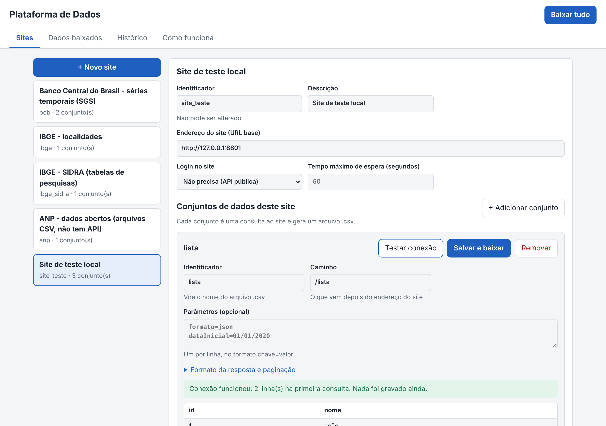

# Manual da Plataforma de Dados

## 1. O que é

A Plataforma de Dados é um programa em Python que conecta em vários sites
(IBGE, ANP, Banco Central e outros) e baixa os dados de todos para uma pasta
do seu computador. Cada site é cadastrado uma única vez; depois, um clique
atualiza tudo.

Ela roda no seu computador e é usada por uma tela no navegador. Nada é
enviado para terceiros: o programa só conversa com os sites que você
cadastrar.



## 2. Como abrir

Requisito: Python 3.9 ou mais novo. Não há mais nada para instalar.

1. Abra o terminal (Prompt de Comando) na pasta do projeto.
2. Rode `python app.py`.
3. O navegador abre sozinho em `http://127.0.0.1:8000`.

Para encerrar, volte ao terminal e aperte `Ctrl+C`. Enquanto o terminal
estiver fechado, a tela não funciona.

Se a porta 8000 estiver ocupada, use outra: `python app.py --porta 9000`.

## 3. Conceitos

| Termo | O que significa | Exemplo |
|---|---|---|
| **Site** | Uma fonte de dados, com endereço e (se preciso) login | IBGE SIDRA |
| **Conjunto de dados** | Uma consulta específica dentro de um site; gera um arquivo | IPCA dos últimos 12 meses |
| **Identificador** | Nome curto, em minúsculas, sem espaços nem acentos; vira nome de pasta ou arquivo | `ibge_sidra`, `ipca_12_meses` |

Um site pode ter vários conjuntos de dados.

## 4. A tela, aba por aba

### 4.1 Sites

À esquerda fica a lista de sites cadastrados; à direita, o formulário do
site selecionado.

**Dados do site**

| Campo | O que preencher |
|---|---|
| Identificador | Nome curto do site. Vira o nome da pasta dos dados. Não pode ser alterado depois de salvo |
| Descrição | Texto livre, aparece na lista |
| Endereço do site (URL base) | A parte comum do endereço, ex.: `https://apisidra.ibge.gov.br` |
| Login no site | Ver seção 5 |
| Tempo máximo de espera | Em segundos. O padrão é 60; aumente para arquivos grandes (a ANP está com 600) |

**Conjuntos de dados do site**

| Campo | O que preencher |
|---|---|
| Identificador | Nome curto do conjunto. Vira o nome do arquivo `.csv` |
| Caminho | O que vem depois do endereço do site, ex.: `/api/v1/localidades/estados` |
| Parâmetros | Opcional. Um por linha, no formato `chave=valor`, ex.: `formato=json` |

Em **Formato da resposta e paginação** ficam as opções avançadas:

| Campo | Quando usar |
|---|---|
| Formato da resposta | `JSON` para APIs; `Arquivo CSV` para sites que publicam arquivos (ANP) |
| Onde está a lista no JSON | Quando os dados vêm dentro de outro campo, ex.: `data.items`. Vazio se a resposta já é a lista |
| A primeira linha traz os nomes das colunas | Marque para a SIDRA/IBGE |
| Separador do CSV | Normalmente `;` em sites brasileiros |
| Codificação do texto | Troque para Latin-1 se os acentos saírem errados |
| Paginação | Ver seção 6 |

**Botões**

| Botão | O que faz |
|---|---|
| Testar conexão | Faz uma consulta e mostra as primeiras 20 linhas. Não grava nada e não exige salvar antes |
| Salvar e baixar | Salva o site e baixa esse conjunto por completo |
| Remover | Tira o conjunto do site (vale ao salvar) |
| + Adicionar conjunto | Cria mais uma consulta no mesmo site |
| Salvar site | Grava as alterações |
| Excluir site | Remove o cadastro. Os dados já baixados são mantidos |

### 4.2 Baixar tudo

O botão **Baixar tudo**, no topo, baixa todos os conjuntos de todos os
sites, um de cada vez, mostrando a situação de cada um. Se um site falhar,
os demais continuam.

### 4.3 Dados baixados

Lista os arquivos já baixados, com número de linhas, tamanho e data.

- **ver** mostra as primeiras 50 linhas na própria tela.
- **baixar .csv** salva uma cópia do arquivo onde você escolher.

### 4.4 Histórico

Registro de todos os downloads: data e hora, site, conjunto, situação
(`ok` ou `erro`), número de linhas e a mensagem de erro, quando houver.

### 4.5 Como funciona

Um resumo deste manual dentro da própria tela.

## 5. Sites que exigem login

| Tipo | Quando usar | O que preencher |
|---|---|---|
| Não precisa | APIs públicas (IBGE, Banco Central, ANP) | Nada |
| Token (Bearer) | O site fornece um "token de acesso" | O token |
| Chave de API | O site fornece uma "API key" | A chave, o nome dela (ex.: `X-API-Key`) e onde é enviada: no cabeçalho ou no endereço |
| Usuário e senha | Login tradicional | Usuário e senha |

As credenciais ficam só no seu computador, no arquivo
`config/segredos.json`, que não vai para o Git. A tela nunca mostra uma
credencial já guardada; para mantê-la, deixe o campo vazio ao salvar.

A documentação de cada site informa qual tipo ele usa.

## 6. Paginação

Algumas APIs entregam os dados em partes. A plataforma busca todas as
partes e junta num único arquivo.

| Tipo | Como o site funciona | Campos |
|---|---|---|
| Não tem | Tudo vem de uma vez | — |
| Por número de página | `?page=1`, `?page=2`... | Nome do parâmetro, parâmetro do tamanho, linhas por página |
| Por posição (offset) | `?offset=0`, `?offset=100`... | Os mesmos |
| Por cursor | Cada resposta informa onde está a próxima | Nome do parâmetro e o campo da resposta com a próxima página, ex.: `meta.next` |

O download para quando uma página vem vazia ou incompleta. "Máximo de
páginas" (padrão 1000) é uma proteção; se for atingido, o histórico avisa
que pode haver mais dados.

## 7. Onde ficam os arquivos

```
config/fontes.json            sites cadastrados (a tela edita esse arquivo)
config/segredos.json          tokens e senhas (só no seu computador)
dados/<site>/<conjunto>.csv   dados baixados
dados/_historico.csv          registro dos downloads
```

- Cada novo download **substitui** o arquivo anterior do mesmo conjunto.
- Os `.csv` usam `;` como separador e abrem direto no Excel.
- Campos dentro de campos viram colunas com ponto, ex.: `regiao.sigla`.

Para ler em Python:

```python
import pandas as pd
ipca = pd.read_csv("dados/ibge_sidra/ipca_12_meses.csv", sep=";")
```

## 8. Baixar sem abrir a tela

Útil para agendar uma atualização diária (Agendador de Tarefas do Windows
ou cron):

```bash
python baixar.py                 # todos os sites
python baixar.py ibge_sidra      # só um site
python baixar.py bcb selic       # só um conjunto
```

## 9. Sites que já vêm cadastrados

| Identificador | Site | Conjuntos |
|---|---|---|
| `bcb` | Banco Central (SGS) | `selic`, `ipca` |
| `ibge` | IBGE - localidades | `estados` |
| `ibge_sidra` | IBGE - SIDRA | `ipca_12_meses` |
| `anp` | ANP - dados abertos | `precos_combustiveis_2024_s1` |

São exemplos e podem ser editados ou excluídos. Use "Testar conexão" em
cada um na primeira vez.

## 10. Exemplo: cadastrar um site novo

Para baixar a lista de municípios do IBGE:

1. Aba **Sites**, selecione `ibge` e clique em **+ Adicionar conjunto**.
2. Identificador: `municipios`. Caminho: `/api/v1/localidades/municipios`.
3. Clique em **Testar conexão** e confira as primeiras linhas.
4. Clique em **Salvar e baixar**.
5. O arquivo aparece na aba **Dados baixados** e em
   `dados/ibge/municipios.csv`.

## 11. Problemas comuns

| Mensagem | Causa provável | O que fazer |
|---|---|---|
| "Sem resposta da plataforma" | O terminal com `app.py` foi fechado | Rode `python app.py` de novo |
| "Não foi possível conectar ao site" | Sem internet, endereço errado ou site fora do ar | Confira o endereço do site |
| "erro HTTP 404" | Caminho errado | Confira o caminho na documentação do site |
| "erro HTTP 401" ou "403" | Login ausente ou inválido | Revise o tipo de login e a credencial |
| "A resposta do site não é um JSON válido" | O site entrega um arquivo, não uma API | Mude o formato para "Arquivo CSV" |
| Acentos errados | Codificação diferente | Troque a codificação para Latin-1 |
| Tudo veio numa coluna só | Separador errado | Ajuste o separador do CSV (`;` ou `,`) |
| "Limite de páginas atingido" | Há mais dados que o limite | Aumente "Máximo de páginas" |

## 12. Limites atuais

- Lê respostas em JSON e CSV. Planilhas Excel (`.xlsx`) e arquivos
  compactados (`.zip`) não são lidos.
- Não guarda versões antigas: cada download substitui o anterior.
- Só faz consultas de leitura (GET); não atende sites que exigem login por
  formulário ou OAuth.
- O agendamento automático não é feito pela tela; use `baixar.py` com o
  agendador do sistema.
